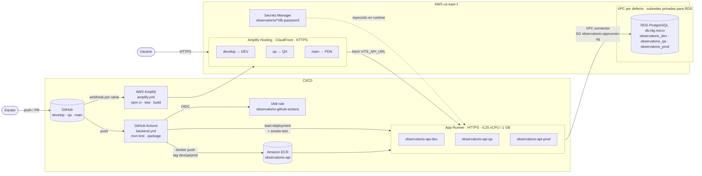
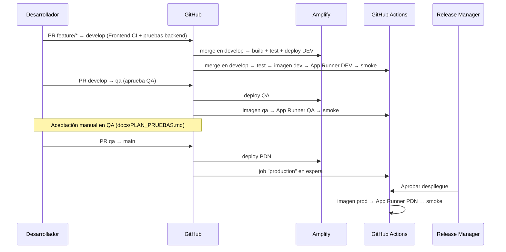

# Arquitectura

Plataforma principal: **AWS Amplify Hosting** (frontend) + **AWS App Runner** (API) + **Amazon RDS for PostgreSQL** (persistencia). El pipeline combina Amplify (frontend) y GitHub Actions (backend).

## Diagrama

## Separación de ambientes

| Ambiente | Rama | Frontend (Amplify) | API (App Runner) | Base de datos | Usuario BD |
|----------|------|--------------------|------------------|---------------|------------|
| DEV | `develop` | `https://develop.<appId>.amplifyapp.com` | `observatorio-api-dev` | `observatorio_dev` | `observatorio_dev` |
| QA | `qa` | `https://qa.<appId>.amplifyapp.com` | `observatorio-api-qa` | `observatorio_qa` | `observatorio_qa` |
| PDN | `main` | `https://main.<appId>.amplifyapp.com` | `observatorio-api-prod` | `observatorio_prod` | `observatorio_prod` |

- Cada ambiente tiene **su propia URL de frontend, su propia API y su propia base de datos con usuario propio**. Un usuario de un ambiente no puede conectarse a la base de otro (`REVOKE ALL ... FROM PUBLIC`).
- Las tres bases viven en **una sola instancia RDS** para mantener el costo dentro del free tier. En un sistema real, PDN tendría su propia instancia (y Multi-AZ).
- El frontend muestra el ambiente en la barra superior (`VITE_APP_ENV`), lo que permite comprobar visualmente que cada URL apunta a un despliegue distinto.

## Configuración por ambiente

| Variable | Dónde se define | DEV / QA / PDN |
|----------|-----------------|----------------|
| `VITE_API_URL` | Amplify, variables por rama | URL HTTPS del App Runner del mismo ambiente |
| `VITE_APP_ENV` | Amplify, variables por rama | `DEV` / `QA` / `PDN` |
| `SPRING_DATASOURCE_URL` | App Runner, variable | `jdbc:postgresql://<rds>:5432/observatorio_<env>` |
| `SPRING_DATASOURCE_USERNAME` | App Runner, variable | `observatorio_<env>` |
| `SPRING_DATASOURCE_PASSWORD` | App Runner, **secreto** (Secrets Manager) | `observatorio/<env>/db-password` |
| `APP_CORS_ORIGINS` | App Runner, variable | URL Amplify de la rama del ambiente |
| `AWS_ROLE_ARN` | GitHub, variable del repositorio | ARN del rol OIDC (no es secreto) |
| `FRONTEND_URL` | GitHub, variable de cada environment | URL Amplify del ambiente (para el smoke test) |

## Flujo de promoción

Un fallo de `npm test`, `mvn test`, del despliegue o del smoke test detiene el pipeline y la versión no avanza.

## Rollback
- **Frontend:** Amplify > rama > Deployments > elegir un build anterior > *Redeploy this version*.
- **API:** GitHub Actions > *Backend CI/CD* > *Run workflow* en la rama del ambiente con `image_tag = <env>-<sha>` de una versión previa (ver tags en ECR).
- **Código:** `git revert <commit>` y push; el pipeline vuelve a desplegar.
